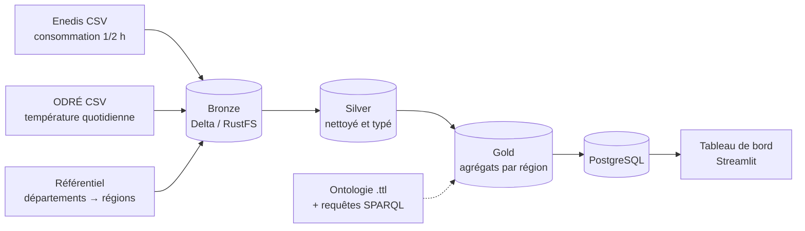
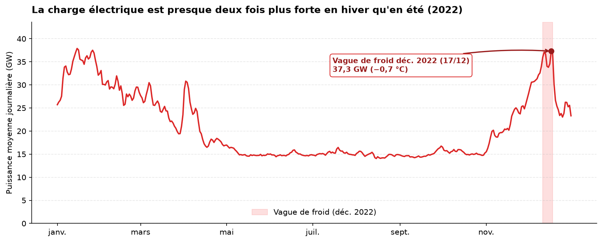
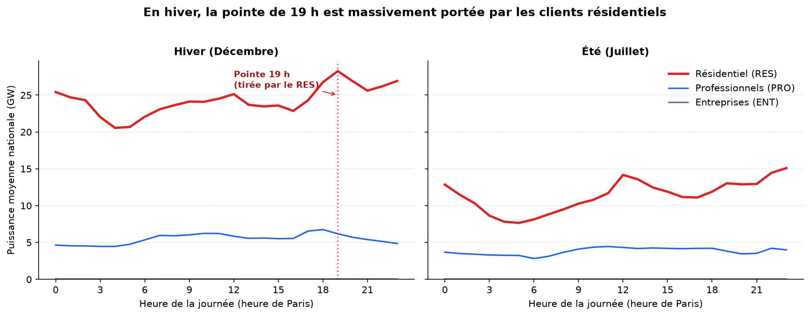
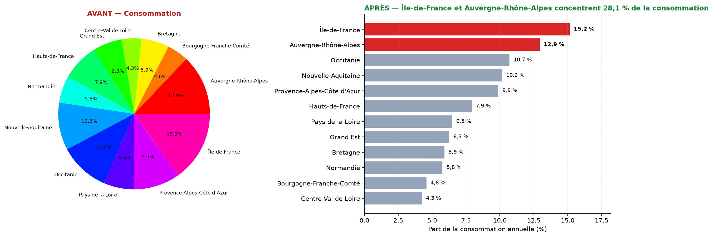
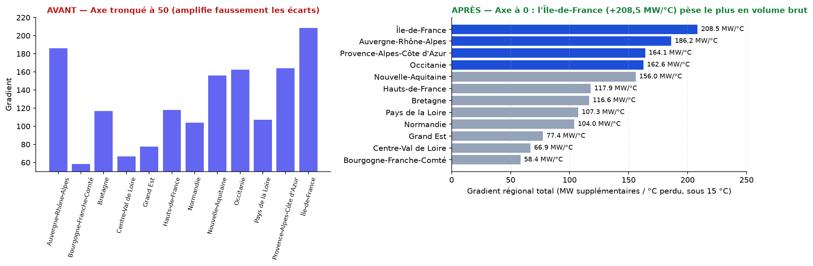
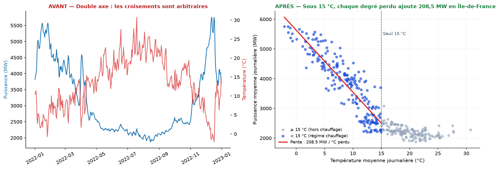
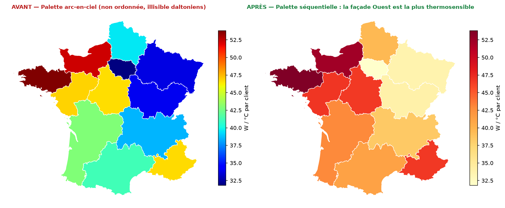
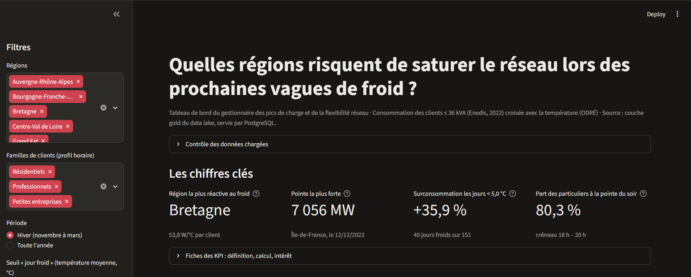

# Consommation électrique et vagues de froid — du data lake au tableau de bord

- **Binôme :** Voahangy RANDIMBIARIVELO · Elyes KASSAB
- **Cours :** Visualisation de données — Mastère Big Data & IA (M1), Sup de Vinci — M. L. NDAO
- **Session :** 2026-2027

Ce dépôt contient toute la chaîne, de la donnée brute au tableau de bord : stockage (bronze, silver, gold),
sémantique (ontologie et requêtes SPARQL), visualisation (notebook d'exploration) et application Streamlit.
Le projet n'étant pas soutenu à l'oral, ce README documente aussi chacun de nos choix.

## 1. Les jeux de données

Pour répondre à la problématique du persona, notre projet s'appuie sur le **croisement de deux
sources de données ouvertes**, téléchargeables par script.

### 1.1 Jeu de données principal : la consommation électrique

| | |
|---|---|
| **Source** | Open Data Enedis — *Agrégats segmentés de consommation électrique au pas 1/2 h des points de soutirage ≤ 36 kVA, maille régionale (2022)* |
| **Lien** | https://www.data.gouv.fr/datasets/677e6c9229987842305739fa |
| **Description** | Historique des consommations électriques agrégées à la **maille régionale**, par profil de client (particuliers, professionnels) et par puissance souscrite. |
| **Dimension temporelle** | Horodatage **demi-horaire** (une valeur toutes les 30 minutes) sur l'année 2022. |
| **Dimension géographique** | Les **régions** de France métropolitaine. |
| **Volume** | 4 fichiers CSV d'environ 425 Mo (≈ 1,7 Go), soit **17 239 680 lignes** : le jeu dépasse largement les 2 millions de lignes attendues. |
| **Licence** | Licence Ouverte / Open Licence 2.0 |

### 1.2 Jeu de données d'enrichissement : la météo

| | |
|---|---|
| **Source** | Open Data Réseaux Énergies (ODRÉ) — *Température quotidienne départementale (depuis janvier 2018)* |
| **Lien** | https://www.data.gouv.fr/datasets/5eb236728ad018f2f0fe1b9e |
| **Description** | Historique des températures **minimales, maximales et moyennes** quotidiennes, par département de France métropolitaine. |
| **Volume** | 309 696 lignes (toutes les années depuis 2018 ; seule 2022 est conservée en silver). |
| **Mise en correspondance** | Les températures départementales sont **moyennées par région** (référentiel `ref/departements_regions.csv`), et la consommation demi-horaire est **agrégée par jour**, pour obtenir la même maille géographique (région) et temporelle (jour) que les données Enedis. |
| **Objectif** | Croiser la température avec la consommation pour modéliser la **thermosensibilité** de chaque région. |
| **Licence** | Licence Ouverte / Open Licence 2.0 |

Les données ne sont **pas versionnées** dans ce dépôt : elles sont téléchargées par un script.

---

## 2. Le persona

| | |
|---|---|
| **Qui ?** | Le **Gestionnaire des Pics de Charge et de la Flexibilité Réseau** chez Enedis. |
| **Que décide-t-il ?** | Le déclenchement d'actions de **flexibilité locale** (effacements, signaux tarifaires) ou la priorisation des **renforcements physiques du réseau** (transformateurs), pour éviter les coupures. |
| **À quelle fréquence ?** | Chaque **semaine**, voire chaque **jour**, pendant la période hivernale (novembre à mars). |

### Sa question principale

> **Quelles régions présentent la plus forte réactivité au froid (thermosensibilité) et risquent
> de saturer la capacité du réseau lors des prochaines vagues de froid ?**

---

## 3. Architecture



Architecture en médaillon : **bronze** (données brutes, sans transformation), **silver** (nettoyage et typage,
chaque règle est comptée), **gold** (agrégats construits pour répondre à la question du persona).

### 3.1 Pourquoi un lakehouse et pas un data warehouse ?

- **Volume et formats** : 1,7 Go de CSV bruts à ingérer tels quels, avant même de savoir ce qui sera utile. Un data warehouse
  demande un schéma défini à l'écriture ; le lac stocke d'abord, structure ensuite.
- **Historique et fiabilité** : Delta Lake ajoute au stockage objet (RustFS, compatible S3) des transactions, un journal des
  versions (*time travel*) et un contrôle du schéma. Démonstration dans `02_silver.ipynb` : la version 0 de `silver/meteo_regions` reste lisible après deux réécritures (section 6.5).
- **Évolutivité** : les données Enedis sont republiées chaque trimestre ; ajouter une période revient à ajouter des fichiers
  au bronze, sans toucher au reste de la chaîne.
- **Coût et simplicité** : tout tourne en local avec Docker, sans licence.

### 3.2 Pourquoi garder un bronze brut si on nettoie ensuite ?

Le bronze est la **copie fidèle de la source**. Si une règle de nettoyage du silver se révèle trop sévère ou fausse,
on la corrige et on rejoue le silver sans retélécharger ni perdre de données. Il garantit aussi que chaque ligne retirée
du silver est **comptée et justifiable** par rapport à un point de départ intact.

### 3.3 Pourquoi le tableau de bord lit PostgreSQL et pas le data lake ?

Les tables gold sont petites et propres : PostgreSQL y répond immédiatement à chaque filtre, alors que lire des fichiers
Parquet du lac à chaque clic serait lent. C'est aussi une source unique pour tous les outils de visualisation.

---

## 4. Structure du dépôt

```
.
├── compose.yaml                  # RustFS, PostgreSQL, Jupyter/Spark, Adminer, Fuseki, Streamlit
├── .env.example                  # variables d'environnement (valeurs par défaut)
├── scripts/
│   └── telecharger_donnees.sh    # télécharge les données dans data/raw (non versionnées)
├── ref/
│   └── departements_regions.csv  # référentiel des 96 départements métropolitains et de leur région
├── commun/                       # utilitaires partagés par les notebooks (Spark, S3, PostgreSQL)
├── notebooks/                    # à exécuter dans l'ordre
├── ontologie/                    # ontologie .ttl et requêtes SPARQL
├── app/                          # application Streamlit (Dockerfile, app.py)
└── docs/                         # captures d'écran et documentation
```

---

## 5. Lancer le projet

**Prérequis :** Git, Docker Desktop (8 Go de mémoire alloués), environ 10 Go d'espace disque libre.
Sous Windows, exécuter les commandes `bash` depuis **Git Bash**.

```bash
# 1. Cloner le dépôt
git clone [https://github.com/voahangyHts/projet-dataviz-randimbiarivelo-kassab.git](https://github.com/voahangyHts/projet-dataviz-randimbiarivelo-kassab.git)
cd projet-dataviz-randimbiarivelo-kassab

# 2. Créer le fichier d'environnement (les valeurs par défaut conviennent)
cp .env.example .env

# 3. Télécharger les données (≈ 1,7 Go, relançable sans risque)
bash scripts/telecharger_donnees.sh

# 4. Démarrer la stack (Jupyter + Spark, RustFS, PostgreSQL)
docker compose up -d
docker compose ps        # jupyter, rustfs, postgres, adminer : « running »
```

**5. Exécuter les notebooks dans l'ordre** depuis JupyterLab : http://localhost:8888/lab?token=projet
(le premier démarrage de Spark télécharge des bibliothèques : prévoir quelques minutes).

| Ordre | Notebook | Rôle | État |
|---|---|---|---|
| 1 | `notebooks/01_bronze.ipynb` | Ingestion des données brutes en Delta (couche bronze) | fait |
| 2 | `notebooks/02_silver.ipynb` | Nettoyage et typage, règles chiffrées | fait |
| 3 | `notebooks/03_gold.ipynb` | Agrégats, thermosensibilité, export PostgreSQL | fait |
| 4 | `notebooks/04_ontologie_sparql.ipynb` | Ontologie et requêtes SPARQL | fait |
| 5 | `notebooks/05_exploration.ipynb` | Exploration et avant/après des graphiques | fait |

**6. Lancer le tableau de bord**

```bash
docker compose --profile app up -d --build
```

Puis ouvrir http://localhost:8501.

### Services et accès

| Service | Adresse | Identifiants |
|---|---|---|
| JupyterLab | http://localhost:8888/lab?token=projet | jeton `projet` |
| Console RustFS (data lake) | http://localhost:9001 | `rustfsadmin` / `rustfsadmin` |
| Adminer (PostgreSQL) | http://localhost:8080 | système PostgreSQL, serveur `postgres`, `projet` / `projet`, base `enedis` |
| Streamlit | http://localhost:8501 | — |
| Fuseki (SPARQL, profil `semantique`) | http://localhost:3030 | `admin` / `admin` |

### Commandes utiles

```bash
docker compose ps                    # état des services
docker compose logs -f jupyter       # journal de Jupyter
docker compose --profile "*" down    # tout arrêter (les données sont conservées)
```

> ⚠️ **Ne jamais taper `docker compose down -v`** : l'option `-v` supprime les volumes, donc le data lake et la base PostgreSQL.

### Dépannage

- **Conflit avec le projet du cours** : les conteneurs portent les mêmes noms (`jupyter`, `postgres`, `rustfs`…).
  Si la stack du cours tourne encore, l'arrêter d'abord : `docker compose -p cours-dataviz down`.
- **Port déjà utilisé** (8888, 9000, 9001, 5432, 8080, 8501) : fermer le programme concerné ou arrêter l'autre conteneur.
- **Spark manque de mémoire** : Docker Desktop → Settings → Resources → 8 Go.

---

## 6. Couche silver : règles de nettoyage

Notebook : `notebooks/02_silver.ipynb`. Le silver est typé (horodate UTC convertie en date-heure de Paris, énergie et nombre
de points en nombres, températures en décimaux ; la valeur « S » du secret statistique devient une valeur vide grâce à `try_cast`)
puis nettoyé. Chaque règle a un nom, une condition et un comptage, selon la méthode de la séance S02.
Une même ligne peut être visée par plusieurs règles : les lignes retirées ne s'additionnent donc pas.

### 6.1 Consommation Enedis (bronze : 17 239 680 lignes)

| Règle | Condition | Justification | Lignes visées | % du bronze |
|---|---|---|---|---|
| `plage_detaillee_hors_P0` | plage de puissance ne commençant pas par « P0 » | La ligne « P0 : Total ≤ 36 kVA » est la somme des autres plages : on ne garde que ce total, pour ne pas compter deux fois la consommation (les bornes des plages varient en plus d'un profil à l'autre) | 14 506 560 | 84,1 % |
| `energie_secret_statistique` | énergie égale à « S » | Secret statistique (trop peu de clients) : aucune valeur exploitable. Dont 157 680 lignes P0, soit 9 séries masquées toute l'année | 1 538 158 | 8,9 % |
| `energie_vide_ou_negative` | énergie vide ou < 0 | Pas de mesure, ou valeur physiquement impossible | 0 | 0 % |
| `aucun_point_de_soutirage` | nombre de points vide ou ≤ 0 | Aucun compteur, donc aucune mesure | 0 | 0 % |
| `horodate_invalide` | horodate non convertible | Date-heure illisible | 0 | 0 % |
| `hors_2022_heure_de_paris` | année ≠ 2022 après conversion en heure de Paris | Hors période d'étude (l'horodate source est en UTC) | 0 | 0 % |
| `doublon` | même (horodate, région, profil, plage) | Éviter de compter deux fois la même mesure | 0 | 0 % |
| `energie_par_point_impossible` | énergie ÷ nombre de points > 18 000 Wh | Un point ≤ 36 kVA ne peut pas soutirer plus de 36 kVA × 0,5 h = 18 kWh par demi-heure | 0 | 0 % |

**Résultat :** 14 664 240 lignes retirées ; **silver/enedis_conso = 2 575 440 lignes (14,9 % du bronze conservé)**,
12 régions, familles de profils RES / PRO / ENT.

### 6.2 Météo ODRÉ (bronze : 309 696 lignes)

| Règle | Condition | Justification | Lignes visées | % du bronze |
|---|---|---|---|---|
| `meteo_date_invalide` | date non convertible | Date illisible | 0 | 0 % |
| `meteo_hors_2022` | année ≠ 2022 | Même période que la consommation | 274 656 | 88,7 % |
| `meteo_hors_referentiel` | département absent de `ref/departements_regions.csv` | Impossible de le rattacher à une région | 0 | 0 % |
| `meteo_hors_perimetre_enedis` | région = Corse | Enedis ne gère pas le réseau corse (EDF) : pas de consommation à comparer | 6 452 | 2,1 % |
| `meteo_temperature_vide` | température moyenne vide ou illisible | Aucune valeur exploitable (3 lignes, toutes hors 2022) | 3 | < 0,01 % |

**Résultat :** 34 310 lignes conservées (94 départements × 365 jours), moyennées par région et par jour :
**silver/meteo_regions = 4 380 lignes** (12 régions × 365 jours).

### 6.3 Les règles à 0 ligne

Six règles ne retirent aucune ligne : le fichier Enedis est propre sur ces points. Nous les gardons, car elles
documentent la qualité vérifiée et protègent la chaîne si la source change (par exemple une nouvelle publication trimestrielle).

### 6.4 Valeurs extrêmes : erreur ou vrai pic de froid ?

Équivalent de la question de la séance S02 (« 0,1 mile à 80 $ : erreur ou cas réel ? »). Sur les 210 216 demi-heures × régions,
**50 dépassent la moyenne de leur région de plus de 3 écarts-types**. Toutes ont lieu en hiver (mi/fin janvier 2022 et vague
de froid du 12 au 17 décembre 2022, jusqu'à −3,5 °C de moyenne journalière), en fin de journée (18 h 30 – 19 h dans la plupart
des régions). Record : Île-de-France, le 12/12/2022 à 19 h, 7 056 MW par −1,5 °C.

Une erreur de mesure serait dispersée au hasard ; ces valeurs suivent le froid et l'heure de pointe. **Ce sont de vrais pics :
on les garde**, car c'est précisément ce que le persona doit anticiper. Seules les valeurs physiquement impossibles sont retirées.

### 6.5 Historique Delta (time travel)

Chaque réécriture d'une table Delta crée une version. La version 0 de `silver/meteo_regions` (4 745 lignes, 13 régions) reste
lisible après deux réécritures ; la comparaison avec la version actuelle (4 380 lignes, 12 régions) montre que la seule
différence est la Corse, retirée par la règle `meteo_hors_perimetre_enedis`.

---

## 7. Couche gold : tables d'agrégats

Notebook : `notebooks/03_gold.ipynb`. Le gold transforme les 2 575 440 lignes du silver en 4 petites tables qui répondent à la question du persona.
Chaque table est écrite dans le lac (`gold/`, Delta) puis exportée dans PostgreSQL pour le tableau de bord.

| Table | Grain (une ligne =) | Lignes | Question du persona |
|---|---|---|---|
| `gold_conso_jour_region` | 1 région × 1 jour : énergie (MWh), puissance moyenne (MW), pointe (MW), nombre de clients, températures, kWh par client | 4 380 (12 × 365) | La consommation suit-elle la température ? |
| `gold_thermosensibilite_region` | 1 région : gradient (MW/°C et W/°C par client), R², pointe 2022, pointe estimée à −5 °C, dépassement (%), rang | 12 | Quelles régions réagissent le plus au froid et risquent de saturer ? |
| `gold_pointe_horaire` | 1 région × 1 famille de clients (RES, PRO, ENT) × 1 mois × 1 heure : puissance moyenne (MW) | 10 368 (12 × 3 × 12 × 24) | À quelle heure tombe la pointe ? |
| `gold_jours_froids` | 1 région × 1 des 10 jours les plus froids : puissance, pointe, surplus par rapport à un jour d'hiver moyen (%) | 120 (12 × 10) | Que se passe-t-il pendant une vague de froid ? |

Choix de calcul :
- **12 régions** : la Corse étant déjà exclue dès le silver (`meteo_hors_perimetre_enedis`), la jointure consommation × météo porte directement sur les 12 régions métropolitaines gérées par Enedis.
- **Charge régionale** : les profils de clients sont additionnés pour chaque demi-heure.
- **Changement d'heure du 30 octobre 2022** : la tranche 2 h – 3 h existe deux fois ; la puissance est moyennée sur les deux occurrences (sinon elle serait doublée), l'énergie est additionnée.
- **Thermosensibilité** : pente de la régression *puissance moyenne journalière ~ température moyenne*, sur les jours sous 15 °C (au-dessus, le chauffage est négligeable). Le gradient est positif : MW supplémentaires pour 1 °C perdu.
  Il est aussi calculé par client (W/°C), ce qui compare les régions quelle que soit leur taille ; le classement `rang_reactivite` repose sur cette colonne.
- **Risque de saturation** : la pointe prévue à −5 °C est extrapolée par la droite de régression, puis comparée à la plus forte pointe de 2022.
  C'est une extrapolation, peu fiable pour les régions qui n'ont jamais approché −5 °C cette année-là (voir « Limites »).
- **Jours froids** : les 10 jours les plus froids de chaque région, comparés à la moyenne des jours d'hiver (novembre à mars) de la même région.

---

## 8. Sémantique : ontologie et requêtes SPARQL

Notebook : `notebooks/04_ontologie_sparql.ipynb` (RDFLib). Fichiers produits dans `ontologie/` :
`ontologie_enedis.ttl` (le vocabulaire, 86 triplets), `graphe_enedis.ttl` (vocabulaire + données, 29 342 triplets)
et `graphe_regions.html` (graphe interactif, capture : `docs/04_graphe_regions.png`).

| Type | Éléments |
|---|---|
| Classes | `Region`, `Departement`, `ProfilClient` (⊃ `ProfilResidentiel`, `ProfilProfessionnel`, `ProfilEntreprise`), `Mesure` (⊃ `MesureJournaliere` ⊃ `MesureJourDeFroid`, et `MesurePointe`) |
| Relations | `Departement situeDans Region` · `Mesure concerne Region` · `MesurePointe pourProfil ProfilClient` |
| Attributs | `nom`, `codeRegion`, `codeInsee`, `gradientMWParDegre`, `gradientWParClient`, `rangReactivite`, `date`, `temperatureMoyenne`, `puissanceMoyenneMW`, `pointeMW`, `mois`, `heure` |
| Interopérabilité | chaque région est reliée à son entité **Wikidata** par `owl:sameAs` |

Données chargées : les 12 régions et leur thermosensibilité, les 94 départements, les 3 familles de clients,
les 4 380 mesures journalières (dont les 120 jours les plus froids, typés `MesureJourDeFroid`) et la puissance à 19 h
par famille et par mois (432 mesures).

**La hiérarchie au travail :** `?m a en:MesureJournaliere` trouve 4 260 mesures ; `?m a/rdfs:subClassOf* en:MesureJournaliere`
en trouve 4 380. Les 120 jours de froid sont déduits de l'ontologie, sans que les données le disent.

| Requête | Question du persona | Résultat |
|---|---|---|
| 1. Régions classées par réactivité, avec leur nombre de départements | Où agir en priorité ? | Bretagne (53,8 W/°C par client), Normandie, Pays de la Loire en tête ; l'Île-de-France est dernière par client mais première en MW/°C (208,5) |
| 2. Puissance des jours de froid comparée à l'année (hiérarchie des mesures) | Que coûte une vague de froid ? | De +59 % (PACA) à +89 % (Centre-Val de Loire) de puissance par rapport à un jour moyen |
| 3. Part des particuliers dans la puissance à 19 h en hiver (hiérarchie des profils) | Qui cibler pour l'effacement ? | 80 à 83 % dans toutes les régions : la flexibilité à la pointe passe d'abord par les particuliers |

**Pourquoi ne pas mettre les 17 millions de lignes dans le graphe ?** Le graphe décrit et relie les concepts ;
le data lake stocke le volume. Le graphe ne contient que les régions, départements, familles et des résultats agrégés du gold.

---

## 9. Visualisation

### 9.1 Notebook d'exploration

`notebooks/05_exploration.ipynb` : évolution annuelle de la consommation, consommation journalière contre température,
gradient par région, profil horaire hiver contre été, carte des régions.





### 9.2 Avant / après

Chaque version « Après » applique aussi un titre qui énonce la conclusion et des axes avec unités explicites.

| Avant (version naïve) | Après (version corrigée) | Principe de perception |
|---|---|---|
| Camembert de la consommation par région | Barres horizontales triées (part de la consommation, %) | La position le long d'un axe se lit mieux que l'angle (Cleveland & McGill) |
| Barres verticales dont l'axe commence à 50 | Barres horizontales triées, axe démarrant à zéro | La longueur d'une barre doit être proportionnelle à la valeur |
| Double axe consommation et température | Nuage de points consommation contre température | Pas de double axe : une relation se montre par un nuage |
| Carte en palette arc-en-ciel | Palette séquentielle | La couleur doit avoir un sens ordonné et rester lisible pour les daltoniens |









---

## 10. Tableau de bord Streamlit

Récit en trois parties : contexte (charge sur l'année, profil horaire par famille), constat (consommation par client contre température, classement et carte des régions), recommandation (actions calculées à partir des données, risque de saturation à −5 °C). Filtres : régions, familles de clients, période (hiver ou année), seuil de jour froid.



### Fiches des KPI

| KPI | Définition | Calcul | Intérêt pour le persona |
|---|---|---|---|
| **Région la plus réactive au froid** (W/°C par client) | Puissance supplémentaire appelée par un client moyen pour chaque degré perdu | Pente de la régression puissance moyenne journalière ~ température moyenne, sur les jours sous 15 °C, divisée par le nombre de clients | Désigne où chaque client réagit le plus au froid : où cibler la flexibilité en priorité |
| **Pointe la plus forte** (MW) | Plus forte puissance appelée sur une demi-heure | max(énergie en Wh × 2 ÷ 10⁶) sur la période et les régions choisies | Mesure le risque de saturation du réseau |
| **Surconsommation les jours froids** (%) | Effet d'une vague de froid sur la charge | (puissance moyenne des jours sous le seuil ÷ puissance moyenne des autres jours) − 1, sur la charge totale des régions choisies | Chiffre ce que coûte un jour froid au réseau |
| **Part des particuliers à la pointe du soir** (%) | Poids des clients résidentiels entre 18 h et 20 h | puissance résidentielle ÷ puissance totale, créneau 18 h – 20 h | Dit qui cibler : effacement chez les particuliers ou chez les professionnels |

---

## 11. Limites et regard critique

- **Année atypique** : 2022 est marquée par la crise énergétique et le plan de sobriété de l'automne ; la consommation a baissé
  pour d'autres raisons que la météo.
- **Extrapolation à −5 °C** : la pointe estimée suppose une relation linéaire sous 15 °C ; elle est peu fiable pour les
  régions qui ne sont jamais descendues sous 0 °C en 2022 (Bretagne, PACA, Nouvelle-Aquitaine, Occitanie).
- **Clients ≤ 36 kVA seulement** : particuliers et petits professionnels ; l'industrie n'est pas couverte, ce qui gonfle
  mécaniquement la part des particuliers dans la pointe (80 à 83 %).
- **Séries masquées** : 9 séries entièrement en secret statistique (« S ») ; certaines régions ont 12 séries de profils, d'autres 13.
- **Secret statistique et séries masquées** : les valeurs « S » masquent les petits groupes (dont 9 séries entièrement masquées toute l'année) ; certaines régions ont 12 séries de profils, d'autres 13.
- **Corse absente** : Enedis ne gère pas le réseau corse ; elle est retirée dès le silver.
- **Changement d'heure** : le 30/10/2022, les deux tranches 2 h – 3 h sont fusionnées (puissance moyennée).
- **Maille régionale** : on ne voit pas les quartiers ; le persona aurait besoin d'une maille plus fine pour décider d'un
  transformateur précis.
- **Température moyenne départementale** : moyenne simple des départements d'une région, sans pondération par la population.
- **Corrélation et causalité** : le froid n'explique pas tout (jours fériés, vacances, week-ends).
- **Graphe RDF** : il ne contient que des résultats agrégés du gold, pas les 17 millions de lignes.
- **Accessibilité** : palettes pensées pour les daltoniens, titres explicites, unités affichées partout.
- **Performance** : Spark pour le volume, tables gold petites dans PostgreSQL, `st.cache_data` dans l'application.

---

## 12. Avancement

- [x] Jeux de données et persona validés
- [x] Script de téléchargement, `compose.yaml`
- [x] Couche bronze (Delta dans RustFS)
- [x] Couche silver (règles de nettoyage chiffrées)
- [x] Couche gold et export PostgreSQL
- [x] Ontologie `.ttl` et requêtes SPARQL
- [x] Notebook d'exploration et avant/après
- [x] Tableau de bord Streamlit (KPI, récit, filtres)